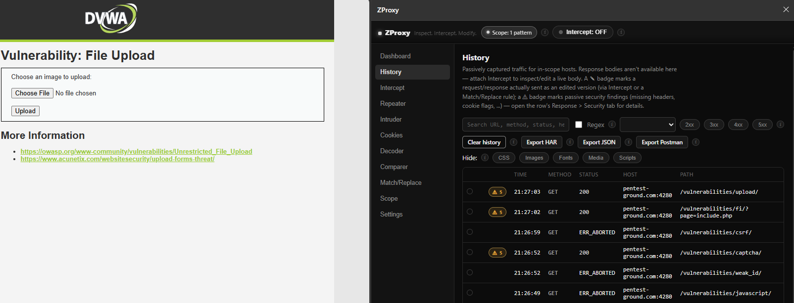

# ZProxy

**Inspect. Intercept. Modify.**

A lightweight, browser-native Chrome (Manifest V3) extension for inspecting
and intercepting your own browser's HTTP traffic, inspired by the day-to-day
Burp Suite / OWASP ZAP intercept workflow — without the standalone-proxy
complexity. ZProxy runs entirely inside Chrome: no companion app, no CA
certificate to install, no backend server.

> **Authorized use only.** ZProxy lets you view and rewrite traffic your own
> browser sends and receives. Only point it at applications you own or are
> explicitly authorized to test. See [`docs/THREAT_MODEL.md`](docs/THREAT_MODEL.md).



## Before you rely on this: an honest status note

This codebase was built following a strict "no mock functionality" rule: every
feature either does the real thing via a real Chrome API, or the README/docs
say plainly that it doesn't and why. Two things worth knowing up front:

- **The interception engine requires `chrome.debugger` (Chrome DevTools
  Protocol).** MV3 removed blocking `webRequest` for ordinary extensions, so
  CDP's `Fetch` domain is the only remaining path to a real pause-edit-forward
  workflow and to response bodies at all. This means Intercept shows Chrome's
  own "ZProxy is debugging this browser" infobar whenever it's attached — that
  is Chrome's behavior, not a bug, and it cannot be hidden. Full rationale in
  [`docs/CAPABILITIES.md`](docs/CAPABILITIES.md).
- **The automated test suite (`tests/`, `node --test`) was written but not
  executed in the environment this was built in**, because that sandbox has no
  Node.js installed (only Python and PowerShell). The tests are ordinary
  `node:test`/`node:assert` files with no framework dependency — run
  `npm test` (Node 18+) yourself to execute them. Don't take "tests exist" as
  "tests are known-green" until you've run them once.

## The core workflow

1. **Intercept** — attach ZProxy to the current tab (header toggle). This
   also adds that tab's exact host to Scope automatically, so attaching
   to a tab is enough on its own — no separate setup step required.
2. **Scope** — review/broaden this any time (add `*.example.com` wildcards,
   exclude a host you don't want touched). Disabled or empty scope means
   ZProxy captures *nothing* (fails closed on purpose); it's never
   "everything" by default.
3. **Browse** the target application normally.
4. A paused request/response shows up in the **Intercept** view — inspect it,
   edit headers/body, and **Forward**, **Drop**, **Forward & don't intercept
   again**, or send it to **Repeater** for repeated experimentation.
5. Everything in scope also lands in **History**, whether or not you paused
   it, for later search/filter/export.

30-second version: *Attach Intercept, browse, edit what pauses, forward it.*
Everything else (Scope tuning, Repeater, Intruder, Decoder, Comparer,
Findings, Match & Replace, Cookies, JWT/JSON inspectors, export) supports
that loop rather than replacing it. "Send to Repeater/Intruder/Decoder/
Comparer" hand-offs are available from History and Intercept alike, so a
row never has to be re-found in a different view to act on it.

Intercept doesn't have to pause everything either: an optional "Pause only
when" rule list (URL/method/body, contains/equals/regex) narrows which
in-scope requests actually stop for manual review — an empty rule list
pauses everything, same as before. And Intercept isn't tied to whichever
tab happens to be active in the browser: a "Managing tab" picker lets you
inspect/act on any currently-attached tab's paused queue independently.

The UI is a plain, monochrome dark theme — every color in
`src/ui/sidepanel/sidepanel.css` and `popup.css` is a true neutral grey
(no hue anywhere); status/severity is conveyed by a lightness ramp
(faint < dim < info < warn < accent < danger) rather than color-coding.
Two deliberate exceptions: passive security findings get a real amber/
orange (so the ⚠ badge actually reads as "worth a look"), and the header's
Intercept toggle turns its frame and status dot red while attached (a
live-recording indicator) — its text and background stay exactly as they
are when off.

## Installing (unpacked, for development/testing)

1. Open `chrome://extensions`.
2. Enable **Developer mode** (top right).
3. Click **Load unpacked** and select this project's root folder
   (the one containing `manifest.json`).
4. Pin the ZProxy icon, and open its side panel (icon → "Open ZProxy panel",
   or the panel toggle in Chrome's toolbar).

No build step. No `npm install` required to run the extension itself — the UI
is plain ES modules loaded directly by Chrome. `npm` is only used to run the
test suite (see above).

## Permissions, and why each one exists

| Permission | Why ZProxy needs it | Granted when |
|---|---|---|
| `storage` | Settings, rules, scope, and (optionally) history, via `chrome.storage`. | Install |
| `webRequest` | Passive, always-on traffic metadata for the History feed — no blocking, so no debugger banner. | Install |
| `declarativeNetRequest`, `...WithHostAccess`, `...Feedback` | "Static" Match & Replace rules (unconditional header set/remove, redirects) that work without attaching a debugger. | Install |
| `cookies` | Full cookie CRUD in the Cookies view. | Install |
| `tabs` | Know which tab is active, to scope Intercept/Repeater/Cookies to it. | Install |
| `sidePanel` | The main UI surface. | Install |
| `downloads` | Saving HAR/JSON/cURL exports and repeater output as local files. | Install |
| `alarms` | Reserved for the history-persistence debounce/cleanup timer. | Install |
| `debugger` | The CDP `Fetch`/`Network` domains that make real pause/edit/forward and response-body access possible. Shows Chrome's own debugging infobar while attached. Chrome does **not** allow this one to be requested at runtime as an optional permission ("Permission 'debugger' cannot be listed as optional") — it's a required permission, shown in the install-time review like every other permission above. | Install |
| `<all_urls>` (optional host permission) | Lets History/Intercept/Repeater/Cookies observe and act on arbitrary origins, and (for Repeater) lets extension-page `fetch()` bypass CORS so cross-origin responses come back readable. `chrome.webRequest` only ever fires for hosts with a granted host permission, so History needs this too, not just Intercept. | First time you enable Scope, click **Intercept**, or use Repeater/Cookies cross-origin |

`<all_urls>` is requested just-in-time with Chrome's own permission prompt —
never silently assumed at install. `debugger` can't follow that model (Chrome
won't allow it to), so it's declared up front instead; it grants no capability
on its own until you actually attach Intercept to a tab.

## What's implemented, and via which API

See [`docs/CAPABILITIES.md`](docs/CAPABILITIES.md) for the full matrix this
project started from. Summary:

| Feature | Backing API | Debugger needed? |
|---|---|---|
| History (traffic log, search/filter/sort/regex-search across headers+body, row tagging/comments, HAR/JSON/cURL/Postman export) | `chrome.webRequest` | No |
| Cookie inspector/editor (full CRUD, `Set-Cookie` parsing) | `chrome.cookies` + `webRequest` header reads | No |
| Static header/URL rules in Match & Replace | `declarativeNetRequest` dynamic rules | No |
| Repeater (resend/edit a request, optional session-handling macro for rotating CSRF/session tokens) | `fetch()` from the extension page | No |
| Intruder (Burp-style automated attacks: mark §positions§, generate payloads, Sniper/Battering ram/Pitchfork/Cluster bomb, payload processing rules, Grep-Match, Search-Extract, session-handling macro, sortable results, response-anomaly highlighting) | `fetch()` from the extension page, same as Repeater | No |
| Decoder (Base64/URL/HTML-entity/Hex encode-decode, SHA-1/256/384/512 hashing) | Pure JS + Web Crypto (`src/parsers/decoder.js`, `src/utils/hash.js`) | No |
| Comparer (word-level diff of any two request/response texts) | Pure JS (`src/parsers/diff.js`) | No |
| Passive security findings (missing security headers, cookie flags, permissive CORS, verbose server banners, secret-shaped strings in bodies, unescaped-reflected request values) | Pure JS, zero extra requests (`src/parsers/passive-checks.js`) — not a scanner | No |
| Findings (every passive finding across History, grouped by kind with an occurrence count, click-through to every affected URL) | Pure JS, reuses `passive-checks.js` (`src/ui/sidepanel/views/findings.js`) | No |
| Keyboard shortcuts (Forward, Send to Repeater, Search, Clear history, Toggle intercept) | Page-level `keydown` listener (`src/utils/shortcuts.js`) | No |
| Intercept: pause/edit/forward/drop requests and responses, conditional "Pause only when" rules, multi-tab "Managing tab" picker | `chrome.debugger` + CDP `Fetch` | **Yes** |
| Response body view/edit | `chrome.debugger` + CDP `Fetch.getResponseBody`/`fulfillRequest` | **Yes** |
| Content-conditional (substring/regex) Match & Replace on headers/body | `chrome.debugger` + CDP `Fetch` | **Yes** |
| WebSocket frame log | `chrome.debugger` + CDP `Network` (observation only — no modification hook exists in CDP) | **Yes** |
| JSON pretty-print/validate/edit | Pure JS (`src/parsers/json.js`) | No |
| JWT inspector | Pure JS, **decode-only, signature never verified** (`src/parsers/jwt.js`) | No |

Passive security findings, when any exist, show up as a **Security** tab in
the shared request/response inspector (so they surface in History, Intercept,
Repeater, and Intruder alike), a ⚠ badge in History rows, and a Dashboard
stat card. Secret detection masks matched values in the UI (e.g. `AKIA…MNOP`)
rather than displaying them in full.

**Explicitly not possible from a browser extension, documented rather than
faked:** true byte-level HTTPS MITM, WebSocket frame modification, and
intercepting traffic from anything other than a Chrome tab ZProxy has
permission for. [`docs/NATIVE_PROXY.md`](docs/NATIVE_PROXY.md) sketches the
seam (`InterceptionBackend`) a future native companion process could fill in
for the MITM case — deliberately not built here.

## Security model

- No telemetry, no analytics, no remote calls the user didn't initiate
  (Repeater sends exactly the request you asked it to send — nothing else).
- Captured HTML/JS is **never** executed inside ZProxy's own UI: rendering
  goes through `textContent`/DOM-node construction or a scripts-disabled
  sandboxed `<iframe sandbox="">` preview — never `innerHTML`, `eval`, or
  `document.write`. Enforced by `src/utils/sanitize.js` and checked by
  `tests/security.no-eval.test.js` and `tests/security.render.test.js`.
- History defaults to `chrome.storage.session` (memory-only, cleared on
  browser restart) specifically because captured traffic can contain
  `Authorization` headers, session cookies, and tokens.
- Full detail: [`docs/SECURITY.md`](docs/SECURITY.md) and
  [`docs/THREAT_MODEL.md`](docs/THREAT_MODEL.md).

## Project structure

```
manifest.json
LICENSE               MIT
src/
  background/       service worker: traffic capture, DNR sync, debugger lifecycle, scope, permissions
  interception/      CDP Fetch-stage request/response/websocket handling, match-replace engine,
                       conditional "Pause only when" Intercept rules
  intruder/           pure functions: §position§ marking/substitution, payload generators, attack-type
                       combination, Search-Extract's wildcard engine, session-handling macros, payload
                       processing rules, results sorting/anomaly detection
  parsers/            pure functions: headers, JSON, JWT, cookies, raw-HTTP/cURL/HAR/Postman, encode/decode,
                       word-level diff, History's header+body search, passive security checks
  storage/            chrome.storage wrappers: settings, rules/scope, Intercept rules, history (ring buffer)
  utils/              bytes (base64<->text for CDP), redact (log hygiene), sanitize (render isolation),
                       hash (SHA-1/256/384/512 via Web Crypto), shortcuts (keybinding parser/matcher)
  ui/
    components/       shared: RPC client, JSON code view, the request/response inspector (incl. its
                       Security findings tab), export helper, fetch()-based sender, session-handling
                       macro editor
    sidepanel/views/   Dashboard, History, Findings, Intercept, Repeater, Intruder, Cookies, Decoder,
                       Comparer, Match & Replace, Scope, Settings
    popup/             quick intercept toggle + "open panel" launcher
docs/                 CAPABILITIES, ARCHITECTURE, SECURITY, THREAT_MODEL, NATIVE_PROXY
tests/                node:test unit tests (parsers, match-replace, scope, security regressions)
examples/
  match-replace-rules/  importable example rule sets + explanation of what each engine can/can't do
  test-lab/              a tiny Node.js practice target (Node required only for this)
```

## Testing

```
npm test
```

Runs `node --test tests/` — plain `node:test`, no test framework dependency.
Covers: header/JSON/JWT/cookie/raw-HTTP/Postman parsing, the Match & Replace
rule engine, Scope's fail-closed behavior, the base64 round-trip CDP payload
encoding relies on, Intruder's position marking/payload generation/attack-type
combination/Search-Extract wildcard engine/session macros/processing rules/
results sorting/anomaly detection, the encode-decode transforms and hashing
behind Decoder, the word-level diff behind Comparer, History's header+body
search, the passive security checks (including secret-signature matching and
reflected-input detection), conditional Intercept rule matching, the
keyboard-shortcut parser, and two security regressions (no dangerous HTML/JS
sinks in shipped source; the `escapeHtml` helper against the OWASP-style
payloads named in the original spec). This suite has not been run in the
environment that produced this code (no Node.js available there) — run it
yourself before you trust it.

### Manual verification checklist (do this in an actual Chrome window)

Automated tests can't drive `chrome.debugger`, render a side panel, or open a
sandboxed iframe, so verify these by hand at least once:

- [ ] Load unpacked, open the side panel, confirm Dashboard renders with no
      console errors.
- [ ] `examples/test-lab`: `node examples/test-lab/server.js`, add
      `localhost` to Scope, attach Intercept, and run through the four demo
      actions (see `examples/test-lab/README.md`).
- [ ] Confirm Chrome's "ZProxy is debugging this browser" infobar appears
      when Intercept attaches and disappears when it detaches.
- [ ] In Intercept, edit a paused request header and confirm the server
      receives the edited value (the test lab's `/api/echo-headers` does
      this for you).
- [ ] Import `examples/match-replace-rules/toggle-feature-flag.content.json`
      and confirm the response body is actually rewritten before the page
      sees it.
- [ ] Open a response with an HTML body and check the **Preview** tab: it
      should render visually but a `<script>alert(1)</script>` embedded in
      that body must **not** execute (no alert box).
- [ ] Cookies view: add, edit, and delete a cookie; confirm it round-trips
      via `chrome://settings/content/all` or DevTools' own Application panel.
- [ ] Repeater: send a request cross-origin with `<all_urls>` granted and
      confirm the response body/headers come back readable.
- [ ] Attach Intercept mid-page-load so multiple resources end up paused at
      once, forward only one of them, then turn Intercept off — the page
      must finish loading (nothing left silently hanging). This exercises
      `detachTab()` resolving every still-pending item before it detaches.
- [ ] Edit a compressed real-world response's body (e.g. an HTML page served
      with gzip/br) and Forward it — the edit must actually render, not hang.
      Then, on a page with several subresources paused at once, click
      **Forward all pending** and confirm the rest release immediately
      without needing to detach Intercept.
- [ ] Edit a request's URL query parameter in Intercept and Forward it. In
      History, the row must show the ✎ badge, and clicking it should default
      to the Request tab showing "Original" vs "Sent (edited)" side by side
      with the actual URL/header/body difference visible. Repeat for editing
      a response body — should default to the Response tab and show the
      real edited body (not "body unavailable", since this comes from the
      interceptor's own capture, not from webRequest).
- [ ] Repeater/Intruder: enable a session-handling macro pointed at an
      endpoint that returns a fresh token, reference it as `{{macro}}` in the
      real request, and confirm the substituted value actually changes
      between sends (not the same value baked in once).
- [ ] Decoder: encode then decode the same text in each mode and confirm it
      round-trips; confirm the hash values update as you type.
- [ ] Comparer: load a request/response pair from History into A and B and
      confirm the diff highlights match what actually differs.
- [ ] Trigger a response missing a security header (or with a plaintext
      `AKIA...`-shaped string in the body) and confirm it shows up under the
      inspector's **Security** tab, the History ⚠ badge, the Dashboard's
      "Passive findings" count (click it — it should land on Findings), and
      as a grouped row with the right count in **Findings**; click that row
      and confirm the affected-URL list, then a URL in it, opens the right
      request/response.
- [ ] Intercept: add a "Pause only when URL contains /api/" rule, browse a
      page that hits both `/api/...` and static assets, and confirm only the
      `/api/...` requests actually pause. Remove the rule and confirm
      everything pauses again. Attach Intercept to two tabs and confirm the
      "Managing tab" picker switches between their paused queues correctly.
- [ ] Run an Intruder attack against an endpoint where one payload behaves
      differently (e.g. a valid vs. invalid credential), click **Length** to
      sort, and confirm the differing response is flagged with a ≠ badge.
- [ ] From a History row, click **Send to Decoder** and **Send to Comparer**
      and confirm each lands the right content in the target view.

## License

[MIT](LICENSE). Not published to the Chrome Web Store.
